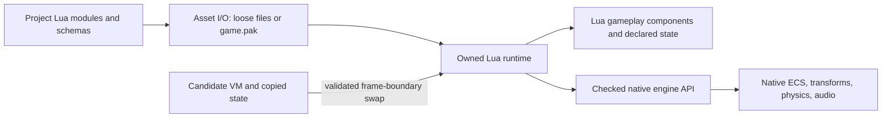

# Lua gameplay scripting research for NOX

Date: 2026-10-12. Scope: research and a measured implementation proposal. The user selected
editor reloads that preserve declared gameplay state on success and retain working code on
failure. This pass adds a standalone compatibility fixture, not scripting to the engine.

## Recommendation

Add a generic Lua gameplay adapter at the existing `IGameModule` boundary. Compile the Lua
runtime and a small engine API once; load each project's Lua modules as content. Put game
rules, gameplay state, and new game-specific component schemas in Lua. Keep rendering,
physics, asset loading, and expensive bulk operations in native engine services.

Editing race rules, a quest system, health logic, dialogue, or an AI state machine would then
require a Lua reload or content repack, without compiling NOX. Adding a new renderer backend
or an engine service that has no binding would still require a native build. Lua can be
statically linked into the engine: dynamic gameplay does not require a dynamically linked DLL.

This includes migrating the current NFS-style car's gameplay policies into project scripts,
not just scripting its race progression. Extract reusable vehicle calculations from DriveMode;
nitrous, drift/reverse/shift decisions, car selection, and presentation belong to the project.
The [NFS car migration](#nfs-car-migration-into-project-scripts) below defines this split.

Use one owned VM per active project/play world, rather than one VM per entity. Support both
ordered project systems and optional entity behaviors through the same host. Use checked
entity handles and deliberate operations, not pointers into component pools. For reload,
prepare a fresh candidate VM, migrate a copied declared-state snapshot, then swap at a frame
boundary only after validation succeeds.



This is a proposed contract. None of these Lua engine classes, scene keys, or APIs exist yet.

## What the supplied material establishes

The supplied 17-slide Lua/ECS lecture demonstrates the essential division: register C++
functions, load Lua files, and let Lua drive HUD, weapon, and dialogue behavior. Its Windows
setup links `lua54.lib` and places `lua54.dll` beside the executable. The examples provide a
useful first embedding exercise, but the production engine should generalize their design.

| Teaching example | Change needed for NOX |
| --- | --- |
| Native `Health`, `Weapon`, and UI structs, slide 8 | New project-only data types must also be definable in Lua, or new systems still require native component additions. |
| HUD system owns a Lua state and hardcoded script paths, slides 9-10 | A project runtime owns the VM; a project descriptor selects modules. The HUD is one client. |
| Raw ECS pointer plus manually allocated `shared_ptr` holder in the registry, slide 12 | Use one native owner and explicit invalidation. NOX's ECS belongs to `SceneGraph`, so this pointer ownership pattern does not fit directly. |
| Health access assumes entity 1, slide 13 | Resolve authored references/tags to checked handles; never assume entity IDs have gameplay meaning. |
| Successful zero-result `lua_pcall` followed by a pop, slide 13 | Restore the recorded stack height. A call with zero results has no result to pop. |
| Script-load error logging without popping its error, slide 10 | Protected calls and balanced stacks on every success and failure path. |
| Bindings registered in construction and again in setup, slides 10 and 16 | Register once per VM. Overwriting the shown registry holder leaks the previous allocation. Clear references during teardown. |

The attachments remain outside the repository and distributions. No lecture images, vendor
headers, library, or DLL have been copied into tracked engine directories.

## Repository findings and integration points

| Current code | Finding and implication |
| --- | --- |
| [CMakeLists.txt](../CMakeLists.txt), [main.cpp](../src/main.cpp), [NoxRacingGame.cpp](../src/NoxRacingGame.cpp) | C++20 sources build into the executable; startup explicitly registers the racing game. The existing boundary separates responsibilities, but does not make its gameplay code independently reloadable. |
| [GameModule.h](../src/GameModule.h) | Configure, Play/Stop, Pause, Update, camera and overlay hooks already offer a place for a generic Lua adapter. Core owns at most one module; registering several factories is not a composition mechanism. |
| [Core.cpp](../src/Core.cpp) | Game Update runs before native animation, transforms, and physics, including in the editor. The adapter must gate simulation on Play/Pause and honor `inputEnabled`. Play requires an available game module, so a Lua project must become playable independently of the racing module. |
| [ComponentTypes.h](../src/ComponentTypes.h) | Native component types and pools are fixed at compile time. Lua-only gameplay component schemas avoid adding Health/Quest/Inventory enums and C++ pools for every project. |
| [ComponentManager.cpp](../src/ComponentManager.cpp) | Deleted entity IDs are reused. `IsEntityValid(id)` only checks present membership, and Clear resets IDs. A stale Lua ID can otherwise address a different entity or scene. |
| [ComponentManager.h](../src/ComponentManager.h) | Component vectors can reallocate and removal swaps the last entry. Raw pointers cannot be retained safely by Lua. `GetComponents()` returns temporary copies, not a mutable view of live storage. |
| [SceneNode.cpp](../src/SceneNode.cpp), [TransformSystem.h](../src/TransformSystem.h) | Transform writes have dirty tracking and physics synchronization semantics. Bind existing host operations rather than exposing writable matrices/component fields that bypass them. |
| [PhysicsEngine.cpp](../src/PhysicsEngine.cpp) | Physics owns a fixed-step accumulator with synchronization before/after stepping. A future `fixed_update` must run at actual substeps, with synchronization designed explicitly; an independent Lua timer would drift from simulation. `SingleStep` needs the same policy. |
| [GameSession.cpp](../src/GameSession.cpp), [DriveMode.cpp](../src/DriveMode.cpp) | Race progression and NFS car policies are migration candidates. DriveMode mixes reusable simulation with compiled nitrous, drift, gearbox/reverse decisions, and camera behavior; extract those policies as described below. |
| [SceneExtensions.h](../src/SceneExtensions.h), [EditorExtensions.h](../src/EditorExtensions.h) | Existing registries support generic scene/editor extensions. They can host script references, declared property inspection, diagnostics, and Reload without adding game-named panels to Core. |
| [AssetPackaging.ps1](../tools/AssetPackaging.ps1) | Runtime extensions currently exclude `.lua`; asset roots exclude project script directories. Packaging will need an explicit script-content contract. Root `scripts/` contains validation tooling and must not be shipped wholesale. |

### Play/Stop is a prerequisite for unrestricted world mutation

`Core::RequestPlay` records game JSON and transforms on existing scene nodes. Stop restores
those transforms on surviving weak references and reconfigures the game. It does not restore
every created/deleted entity, component, or physics state. General scripted spawning and
destruction would therefore escape the current restoration mechanism.

Limit the first engine experiment to explicitly restorable operations on existing entities
and disposable Lua state. Before enabling general structural edits, introduce a disposable
play scene/world restored from the authored scene, or a complete mutation/undo mechanism.
Prefer a disposable play world for the broader engine design, but verify scene cloning and
resource sharing first. Even restricted native writes need documented restoration; arbitrary
rigid-body forces are not automatically covered by the current transform snapshot.

## Runtime version and binding choices

The supplied archive contains five headers, one import library, and one AMD64 DLL. It has no
Lua source, `lua.exe`, or `luac.exe`. Its headers identify Lua 5.4.2; the DLL is 354,816 bytes
(346.5 KiB). The matching header/import-library/DLL combination linked and ran with the local
MSVC x64 compiler. This establishes compatibility for this fixture, not support for every
Debug/Release configuration or engine feature.

As of this research date, the current upstream release is **Lua 5.5.1**, released 2026-08-03.
The final 5.4 release is **5.4.9**, released 2026-08-25, with no further 5.4 releases planned.
Upstream distinguishes ABI-compatible patch releases within a version from incompatible
version changes. Pin matched headers, configuration, library, and target architecture;
moving from 5.4 to 5.5 requires rebuilding the embedding layer.
[Lua version history](https://www.lua.org/versions.html)

Use the attached 5.4.2 bundle for lecture compatibility and this probe, not as the production
dependency by default. Upstream records bugs in 5.4.2 fixed in subsequent releases. For a
new NOX integration, target a pinned source build of current 5.5.1 and review its known
patches; use 5.4.9 if staying compatible with the supplied course is a requirement. Neither
production candidate has been built or validated in this pass.
[Lua bug records](https://www.lua.org/bugs.html#5.4.2)

| Choice | Fit for the first NOX integration |
| --- | --- |
| Small wrapper over the Lua C API | Recommended first. Directly tested with the attachment, no extra binding dependency, and explicit ownership/error contracts. Requires careful stack and lifetime handling. |
| sol2 | Consider when binding volume makes manual registration costly. Use protected functions, pin a revision compatible with the chosen Lua version, and enable documented safety checks. It does not solve NOX entity lifetime or dirty tracking automatically. |

sol2 documents its safety configuration and protected calls. Its documentation alone is not
a verified build against Lua 5.5.1; that combination needs a compile/runtime gate before
adoption. [sol2 safety](https://sol2.readthedocs.io/en/latest/safety.html),
[protected functions](https://sol2.readthedocs.io/en/latest/api/protected_function.html)

Prefer a pinned Lua source dependency built once with the engine's toolchain over committing
copied include/lib/DLL folders into several projects. Static linking avoids another runtime
DLL to stage; DLL linking remains an option if measurements or deployment needs justify it.
Measure actual engine EXE growth for both before claiming a package-size benefit. Keep Lua's
MIT notice with the dependency and distributed attribution.
[Lua license](https://www.lua.org/license.html)

## Proposed engine and project contract

### Ownership and project selection

Proposed native responsibilities:

- `LuaRuntime`: owns state, protected execution, module loading, state snapshots, and reload.
- `LuaGameModule`: adapts existing lifecycle/camera/overlay contracts to Lua.
- `LuaBindings`: exposes a versioned, limited engine API and checked handles.
- `ScriptStorage`: declared project component schemas, authored properties, and runtime data.
  The first storage backend can be Lua tables; it need not become new native component pools.

These names describe responsibilities, not a required file-per-class hierarchy. Keep the
first implementation together where practical. Bootstrap should select a native or Lua
project module from application/project data instead of requiring edits to `main.cpp` for
each project. Existing native racing support can remain a separate selection; compose
native services inside one Lua adapter where required, respecting the single-module owner.

Proposed project content layout and descriptor, subject to implementation review:

```text
projects/<game>/project.json
projects/<game>/scripts/main.lua
projects/<game>/scripts/systems/health.lua
projects/<game>/scripts/systems/quests.lua
```

```json
{
  "runtime": "lua",
  "api_version": 1,
  "entry": "scripts/main.lua",
  "script_roots": ["scripts"],
  "scene": "scenes/example.json"
}
```

Physical project paths map to project-local virtual paths. This descriptor and mapping are
new proposals, not accepted fields in today's launch configuration or packaging profiles.
Scene/entity script references should use logical paths and declared properties; persisted
references need stable authored IDs, not transient native entity numbers. Resolve them to
runtime handles during Configure/BeginPlay.

### ECS access and project-only component data

A native handle should contain a world identity/epoch, entity ID, and entity incarnation.
Check all three on every operation. Add an incarnation counter to native entity management
without replacing existing IDs throughout the engine, and invalidate the world token on
scene teardown/Clear. Existing renderer transform generations are not entity incarnations.
Define overflow behavior and never reset a live world token to an earlier valid identity.

Expose opaque userdata handles and value copies for reads. Do not expose ComponentManager,
SceneNode, vector entries, or raw component pointers. Look up components anew on each call.
Check for missing components and return documented failures. For native writes, use host
operations that preserve transform dirtying, physics, hierarchy, render history, and audio
semantics. Teleports and continuous motion need distinct native behavior.

For project types such as `Health`, store declared data separately, keyed by checked entity
identity. New schemas and systems load from Lua without extending native `ComponentType`.
Clean up gameplay data when entities die and snapshot declared data for reload. Start with
simple scans for Lua-only queries; index them only when real profiling shows a need.

Native queries should return a stable entity-handle snapshot in a defined order. Queue
structural commands until iteration ends, validate targets again at application time, and
keep a clear order for spawn/destroy/reparent. Never let Lua mutate a pool while a native
system traverses it. A failed callback discards its queued native commands; this does not
automatically roll back Lua table mutations. Fault the system and show diagnostics instead
of claiming every runtime error is transactional.

Illustrative project code, using a proposed API, not working engine bindings:

```lua
local M = {}

M.components = {
    Health = { current = "number", maximum = "number" }
}
M.state_schema = { defeated = "integer" }

function M.init(ctx, state)
    state.defeated = 0
end

function M.update(ctx, state, dt)
    for _, entity in ipairs(ctx:query("Health")) do
        local health = ctx:data(entity, "Health")
        if health.current <= 0 and not ctx:has_tag(entity, "defeated") then
            ctx:add_tag(entity, "defeated")
            state.defeated = state.defeated + 1
            ctx:emit("entity_defeated", { entity = entity })
        end
    end
end

function M.migrate(old, old_version)
    return { defeated = old.defeated or 0 }
end

return M
```

Health data and the system are project code. Only generic queries, tags, events, and the
schema/storage contract need native implementation. Define whether gameplay data access
returns copies or live Lua tables; the example assumes Lua-owned live data and queued host
commands. Only declared fields participate in reload/save snapshots.

### Lifecycle, errors, and scheduling

Use explicit lifecycle hooks for initialization, frame update, fixed update, events, stop,
and state migration. Defold provides a primary example of lifecycle callbacks and instance
state; NOX should adapt these ideas to its existing owner and scheduler.
[Defold scripts](https://defold.com/manuals/script/)

Begin with frame updates through `IGameModule`, gated on active Play and Pause. Honor UI
focus for input while allowing non-input simulation according to project policy. Define
system ordering in the project descriptor; do not rely on unordered table iteration.
Deliver native events at designated boundaries instead of allowing reentrant callbacks in
physics/render traversal. On Stop, release VM-owned subscriptions, pending commands, and
callbacks before their native owners disappear.

Do not advertise `fixed_update` until it is connected to the actual physics Step path and
SingleStep. Decide which reads observe synchronized physics state and where kinematic
writes/forces apply relative to PreStepSync, Step, and PostStepSync. Keep the current native
vehicle integrator native; calling Lua once per rendered frame is not a physics substep.
DriveMode currently owns a separate 240 Hz accumulator. Its policy callbacks need the actual
vehicle substeps, not an assumption that PhysicsEngine steps the car (see the migration below).

Protect every script entry with `lua_pcall` and a traceback handler; restore the stack height.
Lua's default C error path uses `longjmp`, so callbacks must avoid crossing live C++ objects
that require destructors. Catch native exceptions before crossing the C API boundary.
Allocator failures and bootstrap calls outside a protected boundary need deliberate handling,
not just protection around Update. [Lua error handling](https://www.lua.org/manual/5.4/manual.html#4.4)

Report virtual filename, line, lifecycle/system name, and traceback in editor diagnostics.
Disable a failing system until a successful reload or explicit retry, keeping the editor
responsive. Production acceptance needs instruction budgets/watchdog hooks, an allocator
limit, and tests for non-string errors and infinite loops. Budgets cannot preempt a blocking
native call, so exposed engine operations must be bounded too. This design targets trusted
project code; executing untrusted mods is a separate security requirement.

## NFS car migration into project scripts

The initial research accounted for race progression but did not fully specify this migration.
The target now explicitly includes the car behaviors described in
[the vehicle rework](nfs2015/game.md#vehicle-camera-and-effects-rework-2026-10-10).
Merely exposing today's `DriveMode::Update` to Lua would leave these behaviors compiled and
would not achieve that target.

### Current implementation and proposed ownership

Many handling/camera values already load from scene JSON. That allows tuning without a build,
but it does not allow changing the behavior itself. The implementation also contains fixed
rig names (`Body`, `Wheel_FL` etc.), fallback geometry, two collision circles, rear-drive
assumptions, and NFS-style control/assist decisions. These need separate owners.

| Existing responsibility | Project Lua/data owns | Reusable native service owns |
| --- | --- | --- |
| `DriveMode::Configure`, rig discovery, Handling/CameraRig defaults | Vehicle definition, authored entity/rig references, dimensions, wheel/axle roles, handling profile, torque/gear curves, spawn, and NFS defaults. | Validate/resolve handles; bind generic rig slots; apply numeric configuration. No R33 asset path or required game node names. |
| `GameSession::ReadInput`, `SelectDirection`, frozen Update branch | Action mappings, throttle/brake interpretation, brake-hold reverse/forward selection, burnout/brake distribution, countdown/rev behavior, reset and refuel decisions. | Focus-aware device/action sampling and validated vehicle actuation. |
| Nitrous inside `DriveMode::Step` | Tank, drain/recharge/cooldown, activation conditions, thrust/top-speed effects, and reset/refuel rules. | Apply validated force/resistance modifiers chosen by the controller. No native nitrous tank or duplicate recharge timer. |
| Drift state machine and NFS assists inside `Step` | Brake-tap window, handbrake/power-over entry, latched drift side, grip recovery, steering/anti-spin assists, and the arcade velocity-swing policy. | Base tire/load calculations and integration; bounded, phase-specific steering, grip, force/torque, and velocity-correction operations. No implicit NFS assist that still runs underneath the script. |
| `UpdateGearbox` and direction state | Automatic up/downshift/kickdown decisions, shift lockout, reverse selection, launch/clutch/rev presentation, and policy timers. | Mechanical ratio/torque/RPM evaluation from data and the selected gear; safe limits. Generic calculation does not autonomously choose a gear. |
| `SampleWheels`, `UpdateVertical`, `Collide`, `UpdateSuspension` | Ground/collision query configuration, vehicle geometry, tuning and recovery policy. | Surface raycasts, contacts, suspension integration, collision resolution, and reusable numeric kernels. Preserve current capabilities first. |
| `ApplyTransforms` | Authored body/wheel/shadow rig mapping and presentation parameters. | Safe transform writes, generic wheel/body posing, interpolation and renderer synchronization. |
| `UpdateCamera` | Chase/far/bumper/free modes, drift framing, speed/nitrous FOV, pull-back, shake, and declared camera smoothing state. | Camera pose/projection, scene queries, and optional reusable spring/collision-avoidance helpers. |
| `GameSession::EmitTyreEffects`, audio/HUD assembly | Slip/wetness thresholds, emitter choice/rates, sound triggers/mix parameters, BOOST gauge policy, and NFS HUD layout/data. | Particle simulation/rendering, audio playback/DSP, and generic UI drawing primitives. |
| Race phases, checkpoint progression, menus, autopilot and maneuver tests | Project systems, event/race state, route-following decisions, and project test fixtures. | Generic navigation/collision queries, persistence services, input and UI primitives. |

In particular, policy includes game-specific assist formulas as well as state transitions.
Moving only drift thresholds to a Lua table while leaving the NFS assist equations in the
engine would still require a C++ build to change the driving feel. Expose a small explicit
actuation contract first and move those equations into the controller; profile before deciding
whether a genuinely reusable numeric helper needs native acceleration.

The first backend can retain the existing four-wheel/two-axle simulation capability. That
does not establish support for arbitrary wheel counts, drivetrains, or other vehicle families.
Make the supported geometry/drive layout explicit and fail unsupported definitions clearly;
do not claim that a rename makes every current hardcoded assumption generic.

### Project content and engine API

Proposed content ownership, inside the earlier project layout:

```text
projects/nox-racing/project.json
projects/nox-racing/data/vehicles/r33.json
projects/nox-racing/scripts/main.lua
projects/nox-racing/scripts/vehicle/nfs_controller.lua
projects/nox-racing/scripts/vehicle/nitrous.lua
projects/nox-racing/scripts/vehicle/drift.lua
projects/nox-racing/scripts/vehicle/gearbox.lua
projects/nox-racing/scripts/vehicle/camera.lua
projects/nox-racing/scripts/vehicle/presentation.lua
projects/nox-racing/scripts/race/session.lua
```

These are logical responsibilities, not a requirement to create one file per feature. Small
policies can share a module. Keep numeric profiles in project data and rules in Lua; reuse one
vehicle profile across scenes with explicit overrides rather than copying a full profile into
every scene. Preserve existing scene JSON through a one-time migration/compatibility reader,
without keeping two competing sets of defaults indefinitely.

The Lua runtime loads ordinary project modules. It does not recognize an `NFSCar` component,
call `RegisterNoxRacingGame`, or expose a game-shaped `run_nfs_car()` API. A generic optional
vehicle service provides checked instances, copied telemetry, validated controls/configuration,
and safe reset/teleport operations. The project composes that service with its Lua controller,
camera, audio/effects, and race systems. More than one car must be an instance of the same
contract, rather than another singleton or another copy of GameSession.

`NoxRacingGame` also registers procedural generators and an interior-atlas scene key. Retiring
that registration must preserve these scene dependencies through project declarations that
invoke reusable native capabilities, or pre-cooked assets. A Lua car adapter alone does not
replace those registrations; account for them when removing the legacy game bootstrap.

Use authored references for body/wheel slots. Capture current geometry/defaults in the R33
profile during migration, including the collision circles and the single-mesh fallback where
needed. Names and model paths remain project content, resolved once through checked handles.
Backend limits/safety defaults may stay native; NFS handling presets must not silently become
universal engine defaults.

### Vehicle timing and behavior parity

`DriveMode::Update` clamps frame dt, runs its own `1/240` substeps, then applies visuals and
camera updates. This is separate from `PhysicsEngine::Update`. Inside each vehicle step,
direction selection precedes force evaluation, while gearbox update follows motion/collision
integration. The arcade velocity-swing assist modifies integrated velocity before collision handling.

The migration must preserve those observation/application phases. Register vehicle-policy
callbacks with the scheduler that actually drives the vehicle backend, with explicit ordered
phases and a common Play/Pause clock. Initially retain the existing vehicle step size and
clamping. A later scheduler consolidation needs its own parity evidence; do not replace
the car's 240 Hz loop with the general physics dt during this migration.

Script input is sampled once per rendered frame and latched for the substeps as appropriate.
Pass telemetry/control snapshots in bulk, use a bounded number of policy calls per phase,
and keep generic physics/suspension/rig loops native. Visual camera, HUD and emission policies
run at their existing frame rate. Native particle pools advance once per frame regardless of
car count. Lua never runs on the SDL audio callback; publish parameters to the native audio
backend from the gameplay thread.

The existing maneuver and gearbox paths in `GameSession::ReadInput` and the game docs are
useful baseline scenarios. Preserve their input timing before moving the fixtures out of
production gameplay code. Lua execution cost at 240 Hz and multi-car scaling are unmeasured.

### Reload ownership for a moving car

Declare and migrate nitrous amount/cooldown, drift blend/side and entry/exit timers, direction
hold, selected gear and shift timers, assist filters, race progress, and camera smoothing
state. Use stable authored vehicle references in snapshots; recreate checked service handles
in the candidate VM. Validate a changed profile against the migrated state, including gear
count and required rig slots. Reject the candidate if migration cannot resolve that change.

The reusable native backend owns physical pose/velocity, contact/suspension history, wheel
motion, and its accumulator. A normal code reload keeps that live instance; it must not
rerun Configure, reset the car, refill nitrous, rewind a race, or lose its current road deck.
Candidate loading/migration cannot issue controls or create/destroy services. Apply new
validated bindings/configuration atomically at the reload boundary; irreversible topology or
backend changes require a Play restart with an explicit diagnostic instead of a silent reset.

Each policy field has one authoritative owner. Transitional code must disable/remove the
equivalent native policy before the Lua version becomes authoritative. A failed candidate
must leave both old script state and the native vehicle unchanged. Stop still needs the
play-world/service restoration discussed earlier; code reload and Stop are different actions.

### Migration order and completion evidence

First extract the native calculations behind checked vehicle instances with the existing
controller behavior unchanged as a baseline. Port nitrous as a small vertical slice, then
direction/gearbox and drift/assist policies in separate parity-checked steps. Move camera,
presentation, input/reset policy, and race progression after their service boundaries exist.
An interim Lua wrapper around native DriveMode is useful scaffolding, not completed migration.

Completion requires:

- Baseline versus Lua-driven telemetry for launch, burnout, brake-hold reverse, kickdown,
  braking/downshifts, nitrous depletion/recharge, brake-tap/handbrake drift, recovery, and
  stacked-road/collision scenarios. Record timing/trajectory tolerances from the baseline.
- Editing nitrous, drift/assist, shift/reverse, camera, and race logic changes behavior while
  the engine executable hash stays unchanged. Hot reload during a drift/shift keeps declared
  state; invalid code/migration keeps the old controller and physical trajectory.
- At least two independent car instances using distinct definitions/rig references, with no
  shared boost/gear/drift/camera state. Unsupported vehicle definitions fail cleanly.
- Generic engine/non-racing scenes run with the NFS project scripts and assets absent. The
  final generic executable does not require `GameSession`, `NoxRacingGame`, or game-specific
  editor/HUD code. CMake's current recursive source glob and native VS source list must be
  partitioned explicitly; moving content alone will not remove compiled game code.
- NFS packages include only their declared Lua/profile/model dependencies, once. Engine-only
  packages exclude them. Script/profile edits require content staging, not an engine build.
- Real vehicle workloads measure Lua/native call cost, GC, frame time, reload memory, and
  behavior across frame rates. The current mock-world probe does not satisfy these gates.

All items in this subsection are implementation targets. No car behavior has been ported or
validated against the engine in this research pass.

## Reload policy selected by the user

Replacing a file or clearing `package.loaded` does not update every captured function/table.
Defold documents a module example where an existing local module reference continues using
the old returned table after reload. A fresh VM avoids having to find and rewrite every old
reference. [Defold module reload behavior](https://defold.com/manuals/hot-reload/#reloading-lua-modules)

The proposed transaction is:

1. At a safe boundary, snapshot only declared system state, gameplay component data, and
   authored properties into bounded native data. Keep integer types, finite numeric values,
   schemas/versions, and stable entity references explicit. Reject cycles, unsupported
   metatables, functions, native pointers, and oversized values with a diagnostic.
2. Read a consistent set of changed modules and dependencies through asset I/O. Record their
   hashes so edits during staging cause a retry instead of mixing module revisions.
3. Create a fresh candidate VM and load all project modules. Top-level loading, migration,
   and validation have no external writes: world commands, subscriptions, audio, file writes,
   and other host effects are blocked. They cannot change the running VM.
4. Validate the module exports, engine API version, component schemas, and each state
   migration. Copy the old snapshot into the candidate; never share mutable Lua tables across
   VMs. Re-resolve saved entity references and enforce the project's missing-entity policy.
5. If validation fails, close the candidate and report the error. Keep old code, old declared
   state, pending active execution, and the native world in place. Retry after another edit.
6. On success, prepare replacement event routes/callbacks and swap at a frame boundary.
   Release old registry references/subscriptions before closing the old VM. Preserve native
   entities and publish the candidate's declared state; do not replay BeginPlay or initializers
   that would reset it. Any post-swap notification is a normal protected callback, not part
   of the already completed transaction.

This preserves declared data, not arbitrary VM internals. Local upvalues, coroutine stacks,
open resources, and function identities are not migrated. Represent timers/tasks as declared
data and recreate them. Persistent save data and authored properties should have explicit
schemas separate from transient reload state. Successful validation cannot prove that every
future Update will succeed; later errors use normal fault handling.

Start with a Reload button. Add a debounced loose-file watcher after the transaction is
reliable. In standalone distributions, mount immutable script content and disable editor
watchers/reload by default. Reloading code must not write the authored scene or pack.

## Loose assets, VFS, and efficient packaging

Implement one buffer-based module loader so loose-file development and future packs use
the same script paths. Load a text chunk with `luaL_loadbufferx(bytes, size, "@scripts/name.lua",
"t")`; a custom Lua-only require/searcher must resolve validated module names through asset
I/O, not the working directory. Remove the default filesystem/native-library module search
paths and expose only selected libraries and host services. `luaL_dofile` in the lecture
should not become the production asset loader.
[Lua loading API](https://www.lua.org/manual/5.4/manual.html#luaL_loadbufferx)

Opening only selected libraries is not enough by itself: remove or replace base-library
`dofile`/`loadfile`, and omit dynamic `load` or constrain it to text. Keep raw `io`, `os`,
`debug`, and native library loading unavailable to gameplay. Expose necessary time, logging,
and user-data operations as explicit host services instead.

This fits the [pack/VFS proposal](pak_vfs_research.md): project Lua modules belong in
`game.pak`, while generic engine assets and services remain shared by engine ownership.
VFS work is still a proposal too. Until it exists, a bounded loose-directory implementation
of the same ReadAll interface can support the first Lua engine experiment.

Packaging needs explicit project script roots, `.lua` support, dependency attribution, and
matching runtime/API metadata. Include all runtime modules under declared roots first:
dynamic `require(variable)` and dynamic asset paths cannot be safely discovered with a
regex. Require explicit asset dependencies where scripts construct paths. Exclude validation
tools, tests, editor-only modules, and other projects. A source subtree remains in the checkout
and cook cache, rather than being duplicated into every distribution.

Ship compressed Lua text initially. Lua bytecode can improve loading but does not make the
code execute faster and is not guaranteed smaller. It depends on VM/architecture compatibility,
so a bytecode cook would need a matching compiler, cache keys, and runtime validation. The
attached bundle has no compiler executable. Preserve source diagnostics; do not treat bytecode
as encryption. [Lua compiler documentation](https://www.lua.org/manual/5.4/luac.html)

Changing Lua text would update content or a pack, not the engine executable. Large single
packs can still amplify small content updates; the earlier VFS proposal's pack ownership and
incremental cook cache apply. Measure a separate scripts pack only if patch sizes justify
another mounted archive. Do not introduce one archive or DLL per entity/system.

## Compatibility probe and measurements

[Probe source](../tools/research/lua_reload_probe.cpp) and
[recorded evidence](research/lua_probe_2026-10-12.json) are deliberately independent of NOX.
The fixture uses the supplied DLL with a one-entity mock world, an integer declared-state
schema, a checked userdata handle, and one buffered native move command.

| Check | Observed result |
| --- | --- |
| MSVC x64, C++20, `/W4 /WX`, supplied headers/lib/DLL | Compile and execution passed. Local installed MSVC toolset: 14.44.35207. |
| External `.lua` edit, identical executable before/after | First script produced count/position 1; edited script produced 10. EXE SHA-256 remained identical. |
| Successful in-process reload | Count 1 survived code replacement; new Update advanced it to 11 and applied the new move amount. |
| Syntax error and migration error | Candidate rejected; active VM identity/count/world position retained; old Update continued. |
| Missing exports and invalid state schema | Candidate rejected without replacing the active VM. |
| Top-level and migration world writes | Rejected before world mutation. |
| Update error after queued native move | Move discarded; Lua stack restored. Arbitrary Lua table mutation is not rolled back. |
| Non-string Lua error | Contained without an unsafe conversion or stack growth. |
| Destroyed entity, recycled ID, replaced world | Each old handle rejected; a fresh VM resolved a new valid handle. |
| Repeated calls/reloads | 1,000 updates and 100 additional reload/update cycles passed without stack growth or loss of the declared count. |
| Disk size | Attached DLL: 346.5 KiB; standalone optimized probe EXE: 45 KiB. Neither is an estimate of final engine growth. |

No engine FPS/startup/memory claims follow from these tests. They do not implement generalized
serialization, real ECS generations, component synchronization, subscriptions, physics hooks,
VFS, editor reload, packaging, watchdogs, or allocator exhaustion handling. They also do not
validate Lua 5.5.1 or 5.4.9. Bootstrap allocations in the fixture are not hardened for OOM,
and its short error messages do not implement the proposed production traceback handler.

### Reproduce the fixture

Verify the provided archive SHA-256 is
`dd4127e66ccb32514d605a417e106f050141e904a78be7257a7fd6f51c73d232`.
Extract it into ignored `build/research/lua/vendor`, retaining `include/`, `lua54.lib`, and
`lua54.dll`. From a VS2022 x64 Developer Command Prompt at the repository root:

```bat
cl /nologo /W4 /WX /EHsc /MD /std:c++20 /O2 /DLUA_BUILD_AS_DLL /Ibuild\research\lua\vendor\include /Fobuild\research\lua\vendor\lua_reload_probe.obj /Febuild\research\lua\vendor\lua_reload_probe.exe tools\research\lua_reload_probe.cpp build\research\lua\vendor\lua54.lib
build\research\lua\vendor\lua_reload_probe.exe --self-test
```

The executable also accepts a Lua file path. Save this example in the ignored research
directory, run it, change the two increments, and run the same executable again:

```lua
local entity = engine.entity()
return {
    migrate = function(old) return { count = old.count } end,
    update = function(state)
        state.count = state.count + 1
        engine.move(entity, 1)
    end
}
```

```bat
build\research\lua\vendor\lua_reload_probe.exe build\research\lua\vendor\example.lua
```

Separate invocations start fresh state. In-process state preservation and failure retention
are exercised by `--self-test`. The probe intentionally needs an external vendor bundle;
it is not added to the engine's build or network-downloading CI.

## Implementation stages and acceptance gates

| Stage | Smallest useful change | Required evidence |
| --- | --- | --- |
| 1. Owned runtime | Pin/build the production Lua dependency; add a generic adapter, buffer loader, protected calls, reload diagnostics, and a project-selected entry point. Keep existing native game mode. | Engine builds; a Lua scene plays without registering racing; editing code changes behavior with unchanged engine binary; failed loads remain usable; native and `--no-game` regressions pass. |
| 2. Safe ECS and project data | Add world/entity incarnation checks, a small restorable transform API, declared Lua component storage, snapshot queries, and command boundaries. | Destroy/reuse/scene-change stale handles fail safely; missing components fail cleanly; query mutation is deferred; transforms/physics/render history stay coherent; new Health and Quest schemas need no C++ edits. |
| 3. Transactional reload | Fresh candidate VM, bounded/versioned declared-state snapshots, migrations, host side-effect gating, subscription replacement, Reload button. | Success keeps declared state; syntax/schema/migration failure keeps working code and world; repeated reloads leave no old references; edits during staging retry coherently. |
| 4. Broader simulation | Disposable play-world restoration before spawn/destroy; actual physics-step hooks and explicit event ordering. | Stop restores authored entities/components/physics; Pause/SingleStep/focus behave correctly; zero/multiple physics substeps dispatch correctly; structural changes cannot invalidate active native iteration. |
| 5. Distribution and migration | Package declared project modules with the selected assets, later through VFS; move one race progression system into Lua before larger rewrites. | Isolated package runs with checkout unavailable; all module/assets present; changing Lua requires only content staging; no unrelated project/tool files; existing racing behavior preserved. |
| 6. NFS car migration | Extract reusable vehicle calculations, then move NFS car policies/presentation into project Lua/data using the explicit migration above. Remove generic-engine dependence on compiled racing code. | Vehicle parity, script-only behavior edits, mid-drive reload preservation/failure retention, separate car instances, and an engine build/package independent of NFS content/code. |

Profile native-to-Lua calls, Lua update/GC time, allocations, live VM memory, reload peak
memory (two VMs plus snapshot), EXE/DLL growth, and incremental content update bytes. Use
representative entity counts and real scene workloads. Keep heavy loops native, minimize
per-field boundary crossings, and add batch operations only after a measured bottleneck.
Set performance budgets using NOX's baseline rather than promising a frame-time result from
this tiny fixture. First adoption should be one observable game rule, not a wholesale rewrite
of GameSession, rendering, or physics.
