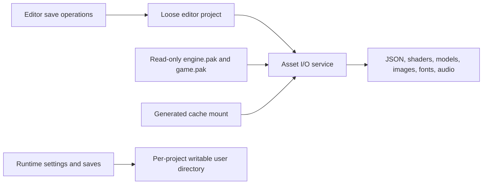

# NOX asset packs and virtual file system research

Date: 2026-10-12. Scope agreed with the user: research, measurements and an implementation
proposal. Target: read-only game packs with loose project assets for editor development.
This document is a proposal; the engine still loads loose files.

## Implementation status (2026-10-12)

The recommendation below is implemented. The sentence above about loose files predates it.

- AssetIO over PhysicsFS 3.2.0 (ZIP and directory archivers), with loose and packed mounts, logical paths kept
  as they were, and a separate writable cache under `generated/`. Details: [asset_io.md](asset_io.md).
- `nox_bootstrap.json` selects packs, user directory and cache at startup. Packs are `engine.pak` and `game.pak`
  (`packaging/engine_owned.json`, `packaging/pack_rules.json`); the packaging workflow is in [packaging.md](packaging.md).
- Cook cache under `build/cook-cache` and procedural results under `generated/cooked/` (`nox_cook`, `src/cook/`).
- Not implemented: the block-indexed Zstd format (still deferred until native measurements justify it).
  Measurements in the sections below remain the reference for the codec and seek choices.
- Tests: `nox_tests AssetIO` (loose/packed parity, corrupt and truncated packs, streams, concurrency) and
  `nox_tests CookedResults`. The packaged-run check (`tools/TestPackagedRun.ps1`) has not been run for this note.

## Recommendation

Introduce one engine asset I/O service, backed initially by PhysicsFS and standard ZIP
archives named `engine.pak` and `game.pak`. Keep existing logical paths such as
`shaders/includes/pbr_common.glsl` and `models/car_r33_rig.glb`. Read archive entries directly
through the service without extracting the archive to disk. Use Deflate for entries that
compress usefully and store the others. Keep large, frequently seeking streams uncompressed
until their actual access pattern is measured.

Prioritize accurate dependency discovery and an incremental cook cache alongside this work.
Compression alone saves approximately 15% of the current Racing asset payload. It does not
remove unused content, convert meshes/textures, or avoid rewriting intermediate assets.
The most promising immediate engine-package reduction is a likely false dependency that
currently accounts for 16.2 MiB of an 18.1 MiB asset payload.

Defer a custom block-indexed Zstd format until native load/seek measurements justify owning
an archive parser and writer. Retain a seekable asset interface from the first implementation
so a future backend can be introduced without migrating every loader again.

## What established engines demonstrate

| System | Verified behavior | Useful lesson for NOX |
| --- | --- | --- |
| Unreal | Cooking prepares target-platform assets and removes unused content; packs group cooked output and can be divided into chunks. | Dependency selection and cooking precede packing. |
| Unity | AssetBundles support whole-content LZMA, independent 128 KB LZ4 chunks, and uncompressed content. | Compression layout determines how much must be decoded for a read. |
| Godot | Its documented PCK format is uncompressed; ZIP is a compressed alternative. Resource packs can be mounted at runtime. | A pack extension alone says nothing about compression or file efficiency. |
| PhysicsFS | Archives and loose directories form one virtual search tree; mount order decides lookup priority. | A maintained library already provides the basic VFS NOX needs. |

Sources: [Unreal packaging](https://dev.epicgames.com/documentation/en-us/unreal-engine/packaging-your-project),
[Unity compression](https://docs.unity3d.com/6000.0/Documentation/Manual/assetbundles-compression-format.html),
[Godot format comparison](https://docs.godotengine.org/en/stable/tutorials/export/exporting_projects.html#pck-versus-zip-pack-file-formats),
[Godot pack loading](https://docs.godotengine.org/en/stable/tutorials/export/exporting_pcks.html),
and [PhysicsFS mounting](https://wiki.icculus.org/PhysicsFS3/PHYSFS_mount).

There is no universal `.pak` specification. The proposed NOX first format uses ZIP signatures
and ZIP stored/Deflate entries with a `.pak` filename. PhysicsFS documents recognizing an
archive by content even with a different extension. It also supports unrelated historical
archive formats; disable unused archive readers rather than treating them as NOX requirements.
[PhysicsFS API header](https://github.com/icculus/physfs/blob/main/src/physfs.h)

Unity also documents that implicitly shared dependencies can be duplicated into several
bundles unless assigned to a shared bundle. NOX should assign each logical asset to one pack
and explicitly identify common engine assets. Splitting a large pack into level packs without
that ownership rule could increase both disk use and loaded copies.
[Unity dependency duplication](https://docs.unity.com/en-us/engine/6000.5/manual/assets-and-media/assets-managing-runtime/assets-avoid-duplication)

## Measurements on this checkout

The benchmark used the actual manifest-selected files from `Package/NOX_Racing` and
`Package/NOX_Engine`, with three trials per file on an AMD Ryzen 7 5800X. The input files
matched their manifest hashes. Editor settings/layout, EXE/DLLs, attribution and runtime-created
files absent from the manifest were excluded. This is a lossless compression measurement,
not a native VFS benchmark or an engine startup benchmark.

Raw input: 216 Racing assets, 166.61 MiB; 139 engine assets, 18.06 MiB.

| Mode | Racing payload MiB | Engine payload MiB | Racing encode CPU s | Racing decode CPU s |
| --- | ---: | ---: | ---: | ---: |
| Stored | 166.61 | 18.06 | - | - |
| Deflate level 6 | 142.14 | 10.54 | 5.668 | 0.346 |
| Zstd level 3 | 143.03 | 11.11 | 0.829 | 0.135 |
| Zstd level 9 | 139.87 | 9.29 | 2.112 | 0.158 |
| LZ4 fast | 153.33 | 15.72 | 0.200 | 0.066 |
| Zstd level 3, independent 256 KiB blocks | 143.46 | 11.01 | 0.658 | 0.159 |
| LZ4 fast, independent 256 KiB blocks | 153.38 | 15.75 | 0.144 | 0.071 |

Each mode stores a file/block if compression saves less than the larger of 64 bytes and 1%.
Times are summed per-file medians for in-memory Python codec calls, including the adaptive
storage decision and output joining. Disk reads, parsing, GPU uploads and cold-start effects
are excluded. Versions: Python 3.11, zlib 1.3.1, Zstd 1.5.7 via Python zstandard 0.25.0,
and Python lz4 4.4.5. The JSON records exact versions and payload/index assumptions.

A standard ZIP container with no extra fields, ZIP64, comments or descriptors would be
approximately 142.17 MiB / 10.56 MiB, including entry names and ZIP headers. That is a sizing
estimate verified against a small real ZIP fixture, not an emitted NOX archive. New VFS library
code size, launcher/bootstrap metadata and splitting into two archives remain unmeasured.

The measured results favor ZIP as the first implementation: Zstd 9 saves a further 2.27 MiB
of Racing payload versus Deflate, while introducing a new runtime format/codec integration.
Zstd 3 encoded much faster but produced a slightly larger payload here. This is a local
finding, not a claim that Deflate generally outperforms Zstd. A block-indexed backend becomes
more attractive if large-file seeking or streaming becomes an actual workload.

PhysicsFS's ZIP source directly seeks stored entries; backward seeks in Deflate entries restart
decoding from the beginning. Consequently, exposing `Seek` is insufficient to claim constant-cost
random access. Large streamed audio and seek-heavy asset formats need stored entries, an owned
decompressed buffer, or a block-seekable backend.
[PhysicsFS ZIP reader](https://github.com/icculus/physfs/blob/main/src/physfs_archiver_zip.c)

Research artifact: [machine-readable results](research/pak_compression_2026-10-12.json).
Reproduction:

```powershell
python -m pip install --target build/research/python --no-cache-dir zstandard==0.25.0 lz4==4.4.5
python tools/benchmark_pack_compression.py --codec-path build/research/python --self-test
python tools/benchmark_pack_compression.py --codec-path build/research/python
```

Optional Python codecs live only under ignored `build/research/python`; they are not engine
dependencies. Without them, the tool measures Deflate using Python's standard library.

## Where the bytes are

| Racing asset type | Input MiB | Zstd 3 savings MiB |
| --- | ---: | ---: |
| JPEG | 70.74 | 0.12 |
| GLB | 41.26 | 12.18 |
| HDR | 28.70 | 8.06 |
| PNG | 23.53 | 1.74 |
| Fonts | 1.21 | 0.55 |
| JSON and shaders | 1.18 | 0.93 |

Whole-file deduplication found only 227 duplicate bytes inside each selected asset set.
Hash-based archive deduplication therefore offers almost no current within-pack saving.
Shared textures embedded inside different GLBs are a separate cooking problem: whole-file
hashes cannot identify or extract those subresources. Cross-project cook-cache reuse can still
be valuable even when there is little duplication inside one distribution.

Two concrete content findings deserve validation before codec tuning:

1. `config/config.json` contains `environmentPath = hdrs/skybox.hdr`. The packaging script scans
   strings and includes this 16.20 MiB file. A source search finds no runtime reader of
   `environmentPath`. `Core::LoadConfiguration` reads environment color, while `SceneLoader`
   loads the scene's explicit `skybox`. The selected Cornell validation scene disables it.
   **Inference:** a semantic dependency scan could eliminate this file from the current
   engine profile, reducing its raw asset set from 18.06 to about 1.86 MiB. Validate an isolated
   package without this asset, including scene saving's legacy skybox serialization, before
   applying that reduction. It has not been removed in this research pass.
2. The default Racing profile includes older night/rain/dawn scenes using `models/car.glb` and
   the sprint scene using `models/car_r33_rig.glb`. Both are genuine references, not identical
   files. Restricting a sprint-only project removes a 11.54 MiB model, but discarding it from
   the current four-scene profile would break those other scenes. Profile scope and cooking
   should make that choice explicit.

Texture cooking should measure installed bytes, decode cost and GPU memory separately.
GPU block compression does not guarantee a smaller disk file than JPEG. Choosing dimensions,
color space, normal-map handling and transcoding formats requires asset-specific quality checks.
Packing existing GLBs also preserves their existing import/parse work; a native cooked mesh or
collision format is a later optimization, not a property of the archive itself.

## Proposed storage architecture



The asset service owns `Exists`, `ReadAll`, `ReadText`, `OpenRead`, `Stat`, `List` and logical
relative-path resolution. `OpenRead` supplies a 64-bit `Read/Seek/Tell/Size` stream. Whole-file
loads return an owned buffer, with its lifetime explicit. Loaders use logical asset names,
not native file handles, disk canonicalization or the process working directory.

For development, mount the loose project at the logical asset root. For shipping, mount the
explicit pack list at that root. Runtime-generated files are confined to a separate cache
mounted at `generated/`; they can override that prefix without overriding shipped shaders
or arbitrary asset paths. Pack inputs cannot contain runtime saves or mutable settings.

Use an executable-relative, small bootstrap file to identify the project, its ordered pack
list and content version. Initialize the VFS before `main.cpp` reads launch presets. This
replaces the current startup requirement that physical `config/` and `shaders/` directories
exist beside the executable. Bootstrap and OS-loaded EXE/DLLs remain physical files.

For settings, read immutable defaults through asset I/O, then apply per-project writable
overrides. Save preferences, speedwall data, snapshots, logs and generated cache files in the
user directory. Editor scene/asset saves explicitly target the writable source project or a
Save As destination. A user's settings directory should not become an unrestricted asset
override mount.

Normalize incoming separators, resolve `.` and `..` lexically within the virtual root, and
preserve model-relative image/buffer and shader-include paths. Reject root escapes and absolute
paths in shipped content. Validate case-colliding names at build time and preserve canonical
asset spelling rather than lowercasing on-disk filenames. Explicit external file import in
the editor remains a physical-file operation with a separate contract.

Start with two disjoint asset ownership sets: engine defaults/shaders/fonts and selected game
content. Preserve current logical paths when splitting packs. Self-contained distributions
still carry their engine pack; local development and builds can mount/reuse a single cached
engine pack instead of copying it into each build configuration.

PhysicsFS provides the mount/search layer and per-file streams, and allows independent handles
to be used by different threads. Keep one stream cursor per consumer; mounts stay fixed after
startup for this scope. Its CMake supports static builds and disabling unused archive readers.
Pin a reviewed version when implementing, enable ZIP, and disable test programs/shared builds
and unused archivers. Measure the resulting executable increase.
[PhysicsFS threading](https://wiki.icculus.org/PhysicsFS3/PHYSFS_seek),
[build options](https://github.com/icculus/physfs/blob/main/CMakeLists.txt),
and [project license](https://github.com/icculus/physfs).

## Integration inventory for NOX

| Area | Verified current access | Required migration |
| --- | --- | --- |
| Startup and config | `main.cpp:43`, `MainWindow.cpp:87`, `Core.cpp:300` | Mount packs before presets/config; separate immutable defaults from writable overrides. |
| Scene data and menus | `SceneLoader.cpp:70,487`, `Core.cpp:1918`, `SceneRenderSettings.cpp:252` | VFS existence/read/list operations; editor saves keep an explicit physical destination. |
| Render and collision glTF | `Scene.cpp:939`, `CollisionWorld.cpp:71` | One shared TinyGLTF filesystem-callback setup for both loaders. |
| Shader sources/includes | `ShaderLoader.h:56,78,149` | Read text through VFS; replace physical canonicalization with logical include resolution. |
| Images and HDR | `Texture.cpp:48`, `Skybox.cpp:81`, `TextureArrayBuilder.cpp:57`, `UiIconAtlas.cpp:47`, `WorldMapUI.cpp:143` | Decode VFS buffers/callbacks; preserve image flipping, color and channel behavior. |
| SDL images/fonts/audio | `GuiNode.cpp:100,118`, `MainWindow.cpp:176`, `AudioPlayer.h:36` | `SDL_RWops` adapter or retained memory buffer for existing SDL APIs. |
| ImGui fonts | `editor/solace/SolaceTheme.cpp:253`, `RacingHUD.cpp:953` | Memory-backed font loading with correct allocator ownership and atlas lifetime. |
| Game JSON and packs | `NightStreetPacks.cpp:34`, `RoadNetwork.cpp:49`, `WorldMapUI.cpp:183,294`, `DriveMode.cpp:268` | Use the same asset service; runtime features still register through game extension points. |
| Procedural generation | `ProceduralStreetKit.cpp:558,2128`, `SceneExtensions.h:19` | Write to generated cache, expose its results under a logical mount; later cook/cache full generator results. |
| Editor browser and persistence | `ImGui/EditorWorkspace.cpp:908`, `RuntimeStateManager.cpp:94`, `GameSession.cpp:1673`, `Input/InputSystem.cpp:953` | Distinguish virtual asset reads from source edits, settings and save-file writes. |

The vendored TinyGLTF already has `FsCallbacks` (`tiny_gltf.h:1329`) and `SetFsCallbacks`
(`:1507`), plus memory-loading entry points. Implement `FileExists`, `ExpandFilePath`,
`ReadWholeFile`, `GetFileSizeInBytes` and an explicit read-only write callback. A top-level
memory load alone is insufficient: external glTF buffers/images still need the callbacks.
Use the virtual model's directory as the base for those references. No importer replacement
is required for the first stage.

STB's vendored headers offer memory/callback decoders. SDL_image, SDL_ttf and SDL_mixer expose
`IMG_Load_RW`, `TTF_OpenFontRW` and `Mix_LoadWAV_RW`. `SDL_RWFromConstMem` does not copy or free
its backing buffer, and a font may keep the stream open until the font closes. Buffer ownership
must therefore outlive its consumers. For ImGui, preserve the atlas's ownership contract rather
than passing a temporary vector to `AddFontFromMemoryTTF`.
[SDL buffer lifetime](https://wiki.libsdl.org/SDL2/SDL_RWFromConstMem),
[SDL images](https://wiki.libsdl.org/SDL2_image/IMG_Load_RW),
[SDL fonts](https://wiki.libsdl.org/SDL2_ttf/TTF_OpenFontRW),
and [SDL audio](https://wiki.libsdl.org/SDL2_mixer/Mix_LoadWAV_RW).

The collision loader also uses TinyGLTF's general model-loading path while consuming geometry
only. Investigate bypassing image decoding or cooking a collision-specific representation;
the possible performance benefit has not been measured in this pass.

## Build/cook pipeline

Proposed flow: dependency graph -> cook cache -> deterministic pack writer -> distribution.
Write packs directly from selected source/cooked entries rather than staging a complete loose
copy and archiving it afterward. Keep the existing profile/manifest workflow as the initial
dependency input, then replace generic JSON string scanning with schema-aware dependencies and
registered generator dependencies.

A cook key includes source hashes, transitive dependency hashes, importer/generator settings,
target platform and cook schema/version. Shader keys include their transitive includes. Reuse
the same compatible cooked/compressed payload across Debug/Release and different output folders.
Skip writing an unchanged pack when its input-manifest hash matches. For changed packs, write
a deterministic temporary archive and atomically replace it after validation. Avoid an endlessly
appended pack that grows with every rebuild. Keep sorted entries, fixed archive timestamps and
versioned manifests so identical inputs produce identical outputs.

For the current district generator, caching just the generated `.gltf` is incomplete. Its
result also carries child prop/light nodes, reflection probes, decals, flares and interior
atlas extras. Serialize/reconstruct the complete versioned generator result or keep generation
as the fallback until that contract exists. Geometry, collision and layout cache keys must
cover scene parameters and the road network as well as referenced assets.

If measurements later justify a custom Zstd backend, its proposal needs a versioned header,
64-bit offsets/sizes, a path-to-payload index and independently compressed block entries.
Benchmark 64/256 KiB sizes and a bounded decompressed-block cache against actual reads; the
256 KiB value measured here is a candidate, not a format commitment. Store incompressible
blocks. Add shared payload IDs only when a new asset corpus demonstrates worthwhile duplication.
PhysicsFS permits registering an archive backend, so a custom reader can reuse its mount layer.
Zstd's project also includes a seekable-format API to evaluate before inventing one.
[Custom archivers](https://wiki.icculus.org/PhysicsFS3/PHYSFS_registerArchiver),
[Zstd seekable API](https://github.com/facebook/zstd/blob/dev/contrib/seekable_format/zstd_seekable.h),
and [Zstd reference implementation](https://github.com/facebook/zstd).

## Staged implementation and acceptance

1. **Loose VFS seam:** introduce the asset service and path/lifetime tests. Migrate JSON,
   shaders and both TinyGLTF loaders. A loose-file build must preserve existing behavior.
2. **Complete loader coverage:** migrate STB, SDL, fonts, enumeration and game readers;
   separate source/user/cache writes. Test model-local URIs, shader includes, fonts and generators.
3. **ZIP-backed packs:** integrate pinned PhysicsFS, deterministic pack writing and bootstrap.
   Boot engine and Racing packages from an unrelated working directory with no loose asset
   trees. Confirm no extraction directory is created and immutable installation files remain unchanged.
4. **Semantic dependencies and cook reuse:** validate pruning the unused HDR/config reference;
   record direct/transitive build dependencies and cache full generator results. An unchanged
   second build must perform no cooking or pack rewrite, and Debug/Release reuse compatible outputs.
5. **Native measurements:** compare cold/warm load times, peak RAM, disk allocation and encode
   time against loose assets. Include stored/compressed seek tests, short reads, concurrent
   independent handles, truncated/corrupt archives, missing assets and exact buffer lifetimes.
   Select a block-Zstd backend only if those results justify it.

The first shipping milestone must cover the entire read path; packing only scenes/shaders while
models or fonts still depend on disk paths would produce an incomplete standalone build.
Mods, DLC, automatic patch mounting and an asset-format rewrite are outside the
agreed first scope. Engine loaders/build behavior have not been changed by this research.
